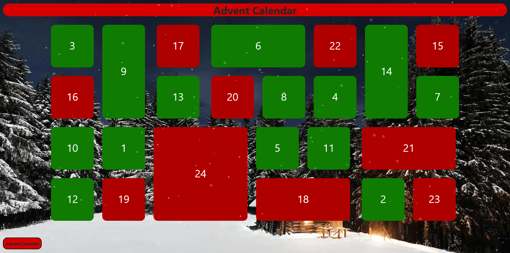

# Advent Calendar

Frontend single-page application (Angular) for the Advent Calendar project.

This repository contains an Angular client located in the `angular-client/` folder.

## Quick start (development server)

Prerequisites:

- Node.js (recommended: 14.x or 16.x LTS)
- npm (comes with Node.js) or yarn

Steps (PowerShell / Windows):

1. Open PowerShell and change into the client folder:

	 cd .\angular-client

2. Install dependencies:

	 npm install

3. Start the development server:

	 npm start

	 This runs the project's `ng serve` script and serves the app at http://localhost:4200/ by default.

Notes and tips:

- The project already includes `@angular/cli` in devDependencies, so a global Angular CLI install is not required. `npm start` will use the local CLI from `node_modules/.bin`.
- To change the port, pass the port flag through npm, for example:

	npm start -- --port 4300

- If you prefer to run the CLI directly with npx:

	npx ng serve --open

- Run tests:

	npm test

- Build for production:

	npm run build

Troubleshooting:

- If `ng` is not found after `npm install`, ensure the install completed successfully and `node_modules` exists in `angular-client/`.
- You can optionally install the Angular CLI globally for convenience:

	npm install -g @angular/cli

## Project structure (brief)

- `angular-client/` — the Angular application. Use the CLI inside this folder for generating components, serving, testing and building.
